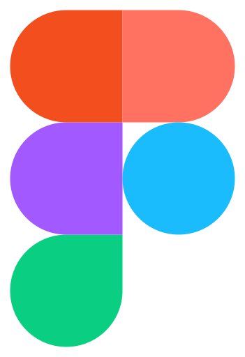

<picture>
  <source media="(max-width: 600px) and (prefers-reduced-motion: reduce) and (prefers-color-scheme: dark)" srcset="assets/work-tall-dark-static.svg">
  <source media="(max-width: 600px) and (prefers-reduced-motion: reduce)" srcset="assets/work-tall-light-static.svg">
  <source media="(max-width: 600px) and (prefers-color-scheme: dark)" srcset="assets/work-tall-dark.svg">
  <source media="(max-width: 600px)" srcset="assets/work-tall-light.svg">
  <source media="(prefers-reduced-motion: reduce) and (prefers-color-scheme: dark)" srcset="assets/work-wide-dark-static.svg">
  <source media="(prefers-reduced-motion: reduce)" srcset="assets/work-wide-light-static.svg">
  <source media="(prefers-color-scheme: dark)" srcset="assets/work-wide-dark.svg">
  
</picture>

I automate finance and reporting functions for enterprise clients. Developer and consultant at [Project2100](https://www.project2100.com), a small consultancy where engineers embed inside the systems a client already uses. I run the discovery and build what comes out of it.

Most of this lives in private client repos, so, briefly:

**Data automation.** Power Automate, Xero, Employment Hero and HubSpot integrations feeding Azure SQL, with Power BI on top. A client's 40-hotel portfolio runs its P&L on a platform I look after.

**AI inside the product.** In-app chat and written commentary on the numbers, grounded in each customer's own data.

**Projos**, Project2100's company system. Client boards, projects, an Outlook calendar, Xero read-only and timesheets drafted from AI sessions. Each person's notes stay private, enforced by Microsoft's permission model rather than app code. Its agents draft and never send.

**[UniOne](https://unione.study)**, a Mac app for University of Sydney students that I built and shipped. Over 100 students use it. It's desktop, not web, because Canvas sends no CORS headers, so a browser app would push every student's token through my server.

Green tests are not evidence, so everything gets exercised against the running system before it counts.

<picture>
  <source media="(prefers-color-scheme: dark)" srcset="assets/skyline-dark.svg">
  
</picture>

Counted on my Mac by [scripts/activity.py](scripts/activity.py) from git history and Claude Code logs, then drawn by [scripts/render.py](scripts/render.py). Counts only: no code, messages or prompts leave the machine.

Final-year at USyd, science and finance, graduating end of 2026.

 

   &nbsp; &nbsp;
  <a href="https://github.com/josh-botha" title="GitHub"><picture><source media="(prefers-color-scheme: dark)" srcset="assets/connect/github-dark.svg" /></picture></a> &nbsp; &nbsp;
   &nbsp; &nbsp;
  <a href="https://x.com/J0SHB0THA" title="X"><picture><source media="(prefers-color-scheme: dark)" srcset="assets/connect/x-dark.svg" /></picture></a> &nbsp; &nbsp;
  <a href="https://unione.study" title="UniOne">unione.study</a>

   &nbsp; &nbsp;
   &nbsp; &nbsp;
   &nbsp; &nbsp;
   &nbsp; &nbsp;
   &nbsp; &nbsp;
   &nbsp; &nbsp;
   &nbsp; &nbsp;
   &nbsp; &nbsp;
  

